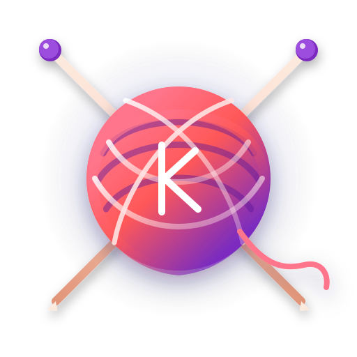

# KNITFORM Official Antigravity Plugin

<p align="center">
  
</p>

<p align="center">
  <strong>KNITFORM 패턴 스튜디오와 Antigravity를 연결하는 공식 플러그인</strong>
</p>

<p align="center">
  <a href="https://knitform.deligh-it.app">KNITFORM 공식 사이트</a> •
  <a href="https://deligh-it.app">DELIGH</a> •
  <a href="#설치-방법">설치 방법</a> •
  <a href="#보안-및-인증">보안 및 인증</a>
</p>

---

## 🧶 KNITFORM 플러그인 소개

**KNITFORM**은 대바늘 및 코바늘 뜨개 창작자를 위한 웹 기반 전문 도안 설계 도구(Pattern Studio)입니다.
본 플러그인은 Antigravity 에이전트와 KNITFORM의 원격 MCP 엔드포인트를 연결하여, 도안 작업 및 데이터 조회를 대화형으로 연동할 수 있도록 지원합니다.

### 주요 기능
- **원격 MCP 연동**: Streamable HTTP 프로토콜을 통해 `https://knitform.deligh-it.app/mcp` 엔드포인트와 통신합니다.
- **도안 데이터 조회**: KNITFORM MCP가 제공하는 도안 데이터 조회 인터페이스를 활용합니다.
- **원클릭 OAuth 연동**: 별도의 API 키 발급이나 JSON 설정 수정 없이, OAuth 2.1 Dynamic Client Registration(DCR)을 통해 안전하게 계정을 승인합니다.

---

## 🚀 설치 방법

일반 사용자는 별도의 설정 파일 수정 없이 바로 설치할 수 있습니다.

### 방법 1: Antigravity 마켓플레이스
1. Antigravity의 **Agent Marketplace**에서 `knitform`을 검색합니다.
2. **Install** 버튼을 클릭합니다.
3. 첫 도구 호출 시 브라우저에서 열리는 OAuth 승인 화면을 통해 로그인 및 승인을 완료합니다.

### 방법 2: 플러그인 카드
채팅창에서 아래 카드를 통해 설치할 수 있습니다:

```markdown
<plugin-card catalog-id="knitform"></plugin-card>
```

---

## 🔒 보안 및 인증 (Streamable HTTP & OAuth DCR)

- **엔드포인트**: `https://knitform.deligh-it.app/mcp`
- **전송 방식**: Streamable HTTP Transport
- **인증 방식**: OAuth 2.1 Dynamic Client Registration (DCR)
  - API 키나 토큰을 플러그인 코드나 저장소에 포함하지 않습니다.
  - Antigravity 클라이언트와 KNITFORM 인증 서버(`https://knitform.deligh-it.app`) 간의 표준 RFC 메타데이터 및 PKCE(S256) 기반 DCR 절차를 통해 안전하게 세션을 맺습니다.

---

## ⚠️ 검증 상태 안내

- **Antigravity CLI 검증 상태**: `agy` CLI 미설치 환경에서 패키징되었으므로 `agy plugin validate --strict` 공식 검증은 **미완료** 상태입니다.
- 공식 검증을 통과하기 전까지는 Google 마켓플레이스 정식 등록 신청을 진행하지 않습니다.
- 로컬 환경에 `agy` CLI 설치 후 아래 명령어로 엄격 검증을 수행할 수 있습니다:
  ```bash
  agy plugin validate --strict .
  ```

---

## 📁 저장소 구조

```text
knitform-antigravity/
├── plugin.json             # Antigravity 플러그인 메타데이터 매니페스트
├── mcp_config.json         # 원격 Streamable HTTP MCP 엔드포인트 정의
├── README.md               # 사용자 안내 및 기술 문서
├── LICENSE                 # MIT License
├── assets/
│   └── logo.svg            # 512x512 벡터 로고
├── skills/
│   └── knitform/
│       └── SKILL.md        # Antigravity 에이전트용 작업 가이드
└── rules/
    └── AGENTS.md           # 플러그인 실행 시 준수되는 데이터 보호 규칙
```

---

## 📄 라이선스 및 문의

- 본 플러그인은 [MIT License](LICENSE)에 따라 제공됩니다.
- 개발 및 운영: **DELIGH** ([deligh-it.app](https://deligh-it.app))
- 서비스 웹사이트: [knitform.deligh-it.app](https://knitform.deligh-it.app)
